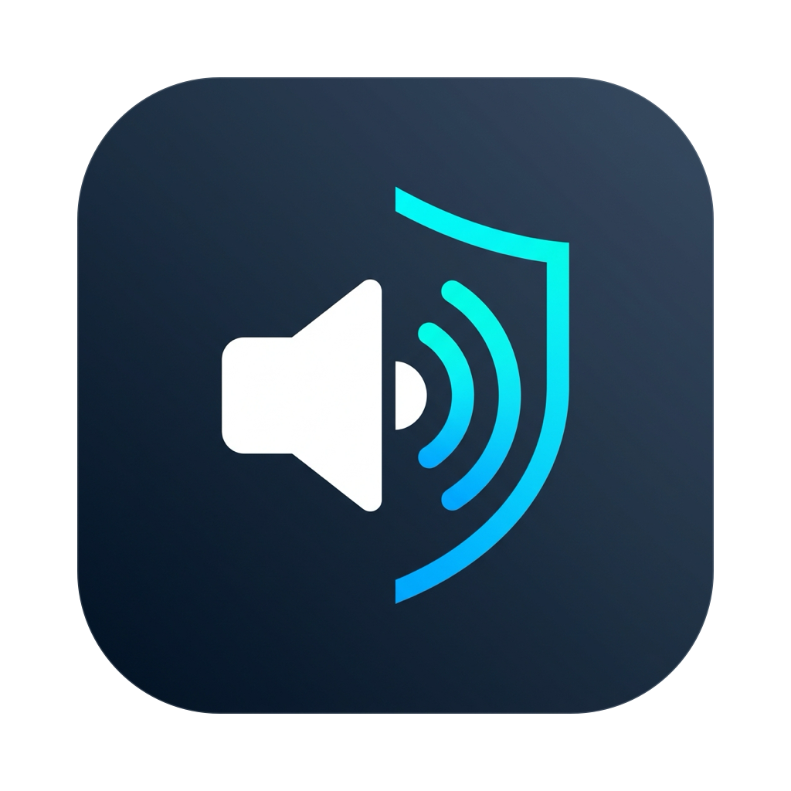
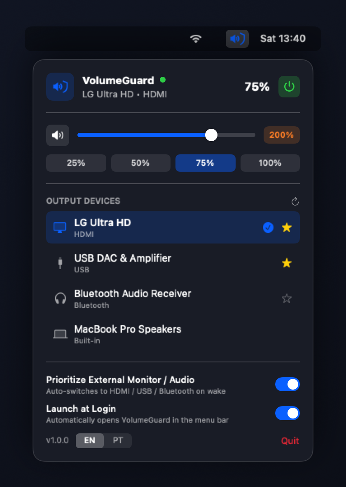
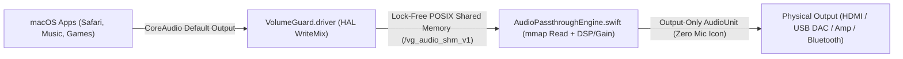

<p align="center">
  
</p>

<h1 align="center">VolumeGuard</h1>

<p align="center">
  <strong>Native macOS Volume Control, Auto-Switch & Lock-Free Virtual Audio Driver for HDMI, DisplayPort, USB DACs/Amplifiers & Bluetooth</strong>
</p>

<p align="center">
  
</p>

---

**VolumeGuard** is a lightweight, dependency-free macOS Menu Bar app + CoreAudio Virtual HAL Driver (`VolumeGuard.driver`) built to fix long-standing macOS audio limitations with external monitors, USB/HDMI/Bluetooth amplifiers, DACs, and wireless audio receivers — **without triggering the macOS orange Microphone privacy indicator**.

It is also designed as a clean, well-documented **open-source reference architecture** for developers who want to build their own macOS virtual audio driver, volume controller, or real-time DSP/EQ app in C11 and Swift.

## What macOS Problem Does VolumeGuard Solve?

- **Blocked Volume & Mute Keys (`F10`, `F11`, `F12`) on External & Digital Outputs:**
  macOS disables native keyboard volume control and grays out the menu bar volume slider whenever audio is routed through **HDMI, DisplayPort, Optical/SPDIF, or many USB DACs and external amplifiers** (and often fails to switch back to external HDMI/USB/Bluetooth outputs when waking from standby). VolumeGuard restores full native media key support, the macOS Volume HUD (`VolumeGuard (Device Name)`), automatic external output priority on wake, and an optional **200% Volume Boost**.

---

## Who Is VolumeGuard Useful For?

- **HDMI & DisplayPort Monitors / TVs:** Control monitor speakers or speakers plugged into your monitor's 3.5mm audio-out jack directly from your Mac keyboard, and never get stuck on MacBook speakers after screen standby.
- **External Amplifiers, DACs & Receivers (USB / HDMI / Bluetooth):** Ideal for desktop headphone amps, stereo amplifiers, audio interfaces, and AV receivers where macOS locks hardware volume controls or fails to reconnect automatically.
- **Bluetooth Audio Sources (Speakers, Headphones & Receivers):** Automatically prioritize your favorite Bluetooth audio receiver or speaker when powered on, apply fine-grained perceptual volume control, and boost quiet sources up to 200%.
- **Developers Building Their Own macOS Audio Apps:** A minimal, modern codebase (~1,300 lines of C11 + Swift 5.9, zero third-party dependencies) that you can fork to build your own macOS audio utility, parametric EQ, limiter, or multi-device router.

---

## Architecture & Using VolumeGuard as a Base for Your Own App

If you want to create your own macOS audio app to fix routing issues or add custom real-time DSP (equalizer, compressor, crossfeed, per-app mixer), VolumeGuard provides all the building blocks out of the box:



- **[`Driver/VolumeGuardDriver.c`](Driver/VolumeGuardDriver.c)**: Self-contained C11 `AudioServerPlugIn` virtual driver (`VolumeGuard_VirtualDevice`). Exposes 44.1 kHz – 192 kHz stereo `Float32` streams, native master volume & mute controls (`kObjectID_Volume_Output_Master`, `kObjectID_Mute_Output_Master`), dynamic HUD device naming (`'vgnm'`), and writes mixed audio frames lock-free into POSIX shared memory (`/vg_audio_shm_v1`).
- **[`Sources/VolumeGuard/Audio/AudioPassthroughEngine.swift`](Sources/VolumeGuard/Audio/AudioPassthroughEngine.swift)**: Real-time `kAudioUnitSubType_HALOutput` render engine that maps `/vg_audio_shm_v1` via `mmap`, performs adaptive ±1-frame linear-interpolated clock drift compensation between the virtual clock and hardware HDMI/USB/Bluetooth clocks, applies perceptual volume gain & soft limiting, and monitors `AudioUnit` render health (`isHealthyAndRendering`). **To add your own DSP/EQ**, simply process the `l` and `r` samples inside `handleOutputCallback`.
- **[`Sources/VolumeGuard/Audio/OutputPriorityManager.swift`](Sources/VolumeGuard/Audio/OutputPriorityManager.swift)**: Coordinates device discovery, preferred device priority, sleep/wake recovery waves (`NSWorkspace` observers + 2s health watchdog), and bi-directional volume synchronization with the macOS OSD HUD.
- **[`Sources/VolumeGuard/System/LaunchAtLoginManager.swift`](Sources/VolumeGuard/System/LaunchAtLoginManager.swift)** & **[`Sources/VolumeGuard/UI/MenuBarView.swift`](Sources/VolumeGuard/UI/MenuBarView.swift)**: Native SwiftUI Menu Bar popover with real-time EN/PT localization, Launch at Login (`SMAppService` + LaunchAgent fallback), and custom CoreGraphics tray icon renderer.

---

## Building & Packaging

### 1. Build Universal Binary (`arm64` + `x86_64`)

Requirements: macOS 13.0+ and Xcode Command Line Tools (`clang` and `swift`).

```bash
./scripts/build.sh
```

Generates:
- `build/VolumeGuard.app` (Menu Bar application with embedded driver)
- `build/VolumeGuard.driver` (Universal CoreAudio HAL plugin)

### 2. Package Redistributable `.dmg` & `.zip` Installers

To build ready-to-distribute archives for any Apple Silicon or Intel Mac:

```bash
./scripts/package-release.sh
```

Generates:
- `build/VolumeGuard-v1.0.0-macOS.dmg` (Drag-and-drop installer with `/Applications` link)
- `build/VolumeGuard-v1.0.0-macOS.zip` (ZIP archive for GitHub Releases)

### 3. Installing the Driver

You can install or update the driver with **1 click** directly inside the **VolumeGuard** menu bar popover (*"Install Driver"*), or via terminal:

```bash
sudo ./scripts/install-driver.sh
```

## Inspiration

Inspired by [eqMac](https://github.com/bitgapp/eqMac), reimagined as a minimal, standalone, dependency-free utility focused specifically on native volume control, lock-free shared-memory audio routing (without triggering the macOS Microphone indicator), and reliable automatic external output switching.

## License

MIT License — see [LICENSE](LICENSE).
